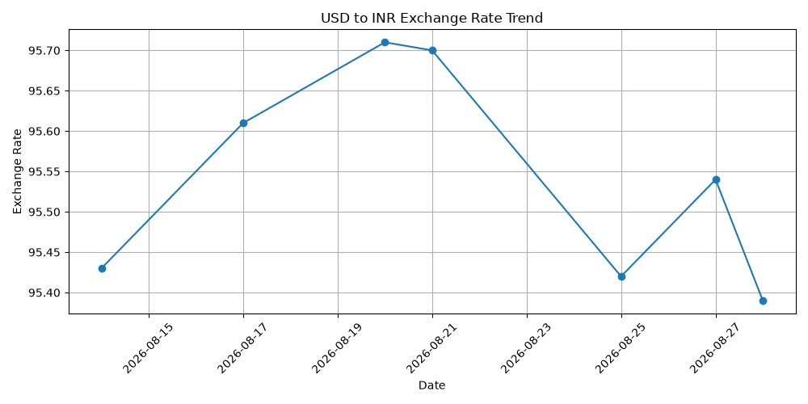

# Personal ETL Pipeline

A small data engineering project to practice the core ETL (Extract, Transform, Load) lifecycle — 
pulling data from a public API, cleaning it, storing it in a database, and eventually visualizing 
trends over time.

This is a learning project, built step by step as part of my self-study data engineering track.

## Goal

Build a simple daily pipeline that:
1. Extracts exchange rate data from a public API
2. Transforms/cleans it using Pandas
3. Loads it into a local SQLite database
4. Runs automatically on a schedule
5. Visualizes the trend over time

## Status
  Completed✅
  
### Step 0: Environment Setup ✅
- Created project folder and Python virtual environment (`venv`)
- Installed core libraries: `requests`, `pandas`, `matplotlib`
- Chose SQLite over Postgres for this first version, to keep focus on 
  learning the pipeline logic rather than database administration

### Step 1: API Research ✅
- Selected the [Frankfurter API](https://www.frankfurter.app/) for exchange rate data
  - No API key required, which keeps the first version simple
- Reviewed API documentation and saved a sample response (`sample_response.txt`)
- Manually tested the API via browser/curl to confirm the response structure
- Identified the fields I actually need: date, and the exchange rate for the currency pair I'm tracking

### Step 2: Extract ✅
- Built `src/extract.py`, which handles only one job: calling the Frankfurter API and returning the raw response
- Used the `requests` library to send a GET request to the exchange rate endpoint
- Added status code checking — if the API call succeeds (status 200), the raw JSON is returned/printed; 
  if not, a clear error message is shown instead of letting the script fail silently
- Verified the script works consistently across multiple runs
- Deliberately tested a broken URL to confirm error handling works correctly before reverting it back
- Kept this file focused purely on extraction — no cleaning or storage logic lives here, to keep each 
  pipeline stage isolated and easy to debug independently
### Step 3: Transform ✅
- Built `src/transform.py`, which handles only one job: turning raw API data into a clean, structured row
- Wrote a `transform_data` function that:
  - Extracts just the fields needed (date and the specific currency exchange rate) from the raw nested JSON
  - Adds a `pulled_at` timestamp to record exactly when each data point was captured — important for 
    building an accurate historical record over time
  - Returns a single clean row as a Pandas DataFrame
- Verified column data types explicitly — confirmed the date is stored as an actual date type (not plain 
  text) and the rate is stored as a number (not a string), to avoid silent bugs later in storage or charting
- Tested the function against real, live data pulled from `extract.py`, not just a static sample, to confirm 
  it behaves correctly end-to-end
- Kept this file focused purely on transformation — it does not call the API itself or write to any 
  database, keeping each pipeline stage independent and easy to debug
### Step 4: Load ✅
- Built `src/load.py`, which handles only one job: saving clean data permanently into a local SQLite database
- Wrote a `create_table()` function that creates the `exchange_rates` table only if it doesn't already exist, 
  making it safe to run on every pipeline execution without wiping existing data
- Added a `UNIQUE(date)` constraint on the table to prevent accidental duplicate rows if the pipeline 
  ever runs more than once on the same day
- Wrote an `insert_data()` function that saves a clean row into the table, using parameterized queries 
  (`?` placeholders) instead of directly inserting values into SQL strings, to avoid SQL injection risks
- Hit and fixed a real bug: SQLite doesn't support Pandas' `Timestamp` type directly. Fixed by explicitly 
  converting `date` and `pulled_at` to plain strings, and `rate` to a plain float, right before inserting — 
  a good example of translating between two tools' different type systems at the boundary where they connect
- Verified duplicate protection works: running the script twice in a row correctly skips the second insert 
  instead of crashing
- Manually inspected the database file to confirm data was actually persisted, not just printed

### Step 5: Combine Into a Pipeline ✅
- Built `src/pipeline.py`, which ties together Extract, Transform, and Load into a single automated sequence
- Refactored `extract.py` and `transform.py` to `return` their results instead of just printing, so their 
  functions could be reused and chained together by the pipeline
- Removed the database, since I forgot to check "PKR" is present in the API response — the API changed its 
  base currency and rate key, causing a `KeyError`. This surfaced the importance of not assuming an external 
  API's response structure stays constant, and validating keys before accessing them
- Added logging (instead of print statements) that writes timestamped entries to `data/pipeline.log`, 
  recording whether each stage (extract, transform, load) succeeded or failed
- Wrapped the full pipeline in a `try/except` block so failures are logged clearly with a reason, instead of 
  the script crashing with no record of what happened — important since this pipeline is meant to run 
  unattended on a schedule
- Tested both success and failure paths: confirmed a full successful run logs correctly and inserts a new 
  row, and confirmed a deliberately broken step logs a clear error message instead of failing silently
### Step 6: Schedule with Cron ✅
- Set up a `cron` job to run `pipeline.py` automatically once daily, without any manual action
- **Bug — macOS cron permissions:** After confirming the pipeline ran cleanly and scheduling it via 
  `crontab -e`, scheduled runs weren't executing at all — no entries appeared in `pipeline.log`, and 
  macOS's system log confirmed cron never even attempted to fire the job. Root cause was macOS's Full 
  Disk Access security restriction, which blocks background processes like cron from running until 
  explicitly granted permission in System Settings → Privacy & Security. Granted access and restarted 
  the machine to apply it, which resolved the issue.
- Also hit and resolved a separate issue where `crontab -e` repeatedly failed with a `bad minute` error 
  despite the cron line appearing correct — worked around it by writing the cron line to a plain text 
  file with `echo` and loading it directly via `crontab /path/to/file`, which bypassed whatever was 
  going wrong in the interactive editor
- Verified success by checking `data/pipeline.log` for automatic, timestamped entries that appeared 
  without any manual script execution
- Updated `load.py` to log the actual inserted exchange rate (not just "load succeeded") so `pipeline.log` 
  gives a genuine at-a-glance summary of what data was captured on each run, without needing to open 
  the database separately
**Known limitation:** since this runs on a personal laptop rather than an always-on server, the 
scheduled job only runs if the machine is awake at the scheduled time. In a production environment, 
this would typically run on a cloud server or use a managed scheduler (e.g., Airflow) to guarantee 
consistent execution.
### Step 7: Visualize Trend ✅
- Built `src/visualize.py`, which handles only one job: reading all stored rows and plotting the trend
- Query explicitly filters `WHERE currency = 'INR'`, as a safeguard against ever accidentally mixing 
  different currencies into the same chart again (see Step 6's currency-column fix)
- Used Matplotlib to generate a labeled line chart (date on x-axis, exchange rate on y-axis), with markers 
  at each data point and saved it as a PNG file
- Verified the chart's values matched the raw database rows before trusting the output
- Excluded the live, auto-regenerating chart (`data/trend_chart.png`) from version control, since it 
  changes every time the script runs — kept one deliberate snapshot (`docs/sample_trend_chart.png`) 
  instead, specifically for showcasing in this README

### Step 8: Orchestrate with Apache Airflow ✅
- Replaced the cron scheduling and the hand-written log file with an Apache Airflow DAG
  (`dags/exchange_rate_pipeline.py`). The ETL logic in `src/` is reused as-is, apart from two small edits:
  a 30-second request timeout, and an optional `date` argument on `extract_data()`. The original
  `pipeline.py` still works on its own.
- The DAG has three tasks, one per stage (`extract_rates` → `transform_rates` → `load_rates`), written with
  Airflow's TaskFlow API (`@dag` / `@task`)
- Schedule: weekdays at 21:00 Asia/Karachi (after the ECB publishes that day's reference rates), `catchup=False`
- Each run asks the API for the rate of its own logical date, so a backfill fetches real historical rates
  instead of re-fetching today's
- Each task retries up to 3 times, one minute apart. Per-task logs and run history in the Airflow UI
  replace `data/pipeline.log`
- Setup: Airflow 3.3.2 on WSL Ubuntu, in its own virtual environment outside the repo, built on Python 3.12
  (via uv) and installed with the official constraints file. My system Python is 3.14, which I avoided
  for Airflow as a precaution against dependency problems. `dags_folder` in `airflow.cfg` points at this
  repo's `dags/` folder

**What I verified**
- Triggered the DAG manually and by schedule: all three tasks succeed and the load step inserts the row
- Broke the API hostname on purpose: `extract_rates` went into `up_for_retry`, and after I restored the URL
  the next retry succeeded without any manual re-run
- My database had no rows for 1, 2, 6, 7 and 8 October 2026.
  `airflow backfill create` for 2026-10-01 to 2026-10-09 created six runs and filled all five gaps. The row
  that already existed was not duplicated, because the load step is idempotent (`UNIQUE(date, currency)`)

**Bugs and surprises**
- **Design catch — swallowed exceptions:** `run_pipeline()` catches every exception and only logs it.
  Airflow judges a task by whether it raises, so a dead API would have shown as a green run and never
  retried. The DAG therefore calls the stage functions directly instead of `run_pipeline()`.
- **Bug — `airflow dags list` crashed after I turned off the example DAGs:** Airflow had already stored the
  examples in its metadata database during the first run, and one of them needed a plugin that was no
  longer loaded. `airflow db reset` fixed it; nothing of mine was in that database.
- **Bug — copying the project from Windows into WSL:** git reported every file as modified and
  `README.md`, `Procfile` and `docs/` as missing. The "modified" noise was CRLF vs LF line endings. I
  re-copied the three missing items and set `core.autocrlf input`. The Windows `venv` was useless in
  Linux and had to be deleted.
- **Surprise — a stray scheduled run:** I changed the schedule and the timezone in two separate edits,
  and Airflow most likely parsed the file in between, creating one scheduled run with a 21:00 UTC logical
  date. It was harmless because the load step skips duplicates.

**Known limitation:** Airflow's scheduler only fires while it is running (`airflow standalone` in a
terminal on a personal laptop), so a run can still be missed. What changed is that a missed day is now
visible and recoverable with a backfill. A production setup would run Airflow as an always-on service.

## Sample Output

## Tech Stack

- Python 3
- Pandas
- SQLite
- Frankfurter API (exchange rates)
- Matplotlib (trend chart)
- Apache Airflow 3 (orchestration)

## Why This Project

Built to practice the full data engineering lifecycle hands-on — generation, ingestion, 
transformation, and storage — rather than just reading about it. Each step is committed 
separately to show the build process, not just the final result.
